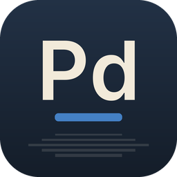

<p align="center">
  
</p>

<h1 align="center">PDF · Suíte FisiLab</h1>

<p align="center">
  <b>Leitor e editor de PDF</b><br>
  Alternativa livre ao <b>Adobe Acrobat</b>
</p>

<p align="center">
  Disponibilizado pelo <b>FisiLab — LARFIC · UFRGS</b> em parceria com o <b>CTA — Centro de
  Tecnologia Acadêmica</b>, para estudantes, professores e técnicos da UFRGS.
</p>

---

O **FisiLab PDF** (nome curto **PDF**) faz parte da [Suíte FisiLab](https://github.com/mrcandrade/larfic/tree/main/suite-fisilab):
programas livres para ensinar, pesquisar e criar na universidade. Ele é uma versão modificada do
[PdfCraft](https://github.com/storytold/pdfcraft), um aplicativo de PDF de código aberto escrito em
Rust, e funciona sem conta, sem telemetria e sem nuvem.

## O que faz

- **Lê qualquer PDF com fidelidade**: tipografia real, escritas do mundo todo (inclusive árabe,
  hebraico e japonês vertical), emoji colorido, degradês, transparências e camadas opcionais.
- **Encontra, seleciona e copia** texto, com busca no documento, marcadores e miniaturas das
  páginas para navegar em documentos longos.
- **Organiza páginas como cartas na mesa**: girar, apagar, inserir páginas em branco ou de outro
  arquivo e reordenar, com desfazer ilimitado que continua funcionando depois de salvar.
- **Combina e divide** documentos sem perder links, campos de formulário, camadas e anexos;
  extrai as páginas escolhidas para um novo arquivo.
- **Abre documentos protegidos e respeita as suas regras**: todo o tratamento de segurança padrão
  do PDF (de RC4 de 40 bits a AES-256), senhas de usuário e de proprietário, e mostra as
  permissões em Propriedades do documento.
- **Comentários, formulários, camadas e anexos**: anotações em conversa, preenchimento de
  formulários, assinatura e um catálogo com todas as ferramentas a uma tecla de distância
  (<kbd>Ctrl</kbd>+<kbd>K</kbd>).
- **Salva com segurança**: as gravações são incrementais (os bytes originais ficam intactos) e
  atômicas, com salvamento automático e recuperação depois de um fechamento inesperado.
- **Linha de comando e automação**: o `fisilab-pdf-cli` inspeciona, renderiza, combina, extrai e
  divide PDFs, e pode ser usado em scripts.

## Instalação

### Windows

Baixe o instalador `FisiLab-PDF-Setup-<versão>.exe` no portal de downloads da
[Suíte FisiLab](https://github.com/mrcandrade/larfic/tree/main/suite-fisilab) ou na página de
[versões do FisiLab PDF no GitHub](https://github.com/mrcandrade/fisilab-pdf/releases) e execute-o.
A interface já abre em português do Brasil, no tema **UFRGS Noite** (o tema **UFRGS Dia** e os
temas originais ficam em *Menu → Exibir → Tema de exibição*).

### Compilar a partir do código

É preciso o Rust 1.95 ou mais recente ([rustup.rs](https://rustup.rs)).

```sh
git clone https://github.com/mrcandrade/fisilab-pdf
cd fisilab-pdf
cargo xtask models                               # baixa os modelos de OCR usados por "Digitalizar e OCR"
cargo run --release -p pdfcraft -- arquivo.pdf   # o aplicativo (fisilab-pdf.exe)
cargo run --release -p pdfcraft-cli -- --help    # a linha de comando (fisilab-pdf-cli.exe)
```

Os pacotes Rust mantêm os nomes do projeto original (`pdfcraft`, `pdfcraft-cli`, …); os
executáveis gerados se chamam `fisilab-pdf` e `fisilab-pdf-cli`. Notas de desenvolvimento estão em
[docs/development.md](docs/development.md).

## Créditos

O FisiLab PDF é baseado no **[PdfCraft](https://github.com/storytold/pdfcraft)**, criado pelo
**ArtCraft Team e contribuidores**, e distribuído, como o original, sob a licença
[MIT](LICENSE-MIT) ou [Apache 2.0](LICENSE-APACHE), à sua escolha. Todo o trabalho de leitura,
edição e formatos de arquivo é deles; agradecemos a todas as pessoas que contribuíram.

- [NOTICE](NOTICE): avisos de licença do projeto e do material de terceiros;
- [ATTRIBUTION.md](ATTRIBUTION.md): a lista de ícones, fontes e modelos incluídos, com autores e licenças;
- [README.upstream.md](README.upstream.md): o README original do PdfCraft;
- [MODIFICACOES.md](MODIFICACOES.md): o que o FisiLab mudou nesta versão.

Os nomes e marcas do projeto original pertencem aos seus titulares. Esta versão não é afiliada
ao ArtCraft Team nem endossada por ele.

## Manifesto

Conhecimento produzido em uma universidade pública deve circular livremente, e as ferramentas que
usamos para ensinar, pesquisar e criar também: leia o
[Manifesto pelas tecnologias livres](https://github.com/mrcandrade/larfic/blob/main/suite-fisilab/MANIFESTO.md).

---

<p align="center">
  <a href="https://www.ufrgs.br"></a>
  &nbsp;&nbsp;&nbsp;
  <a href="https://cta.if.ufrgs.br"></a>
  &nbsp;&nbsp;&nbsp;
  
</p>

<p align="center"><sub>FisiLab — LARFIC · UFRGS · Suíte FisiLab</sub></p>
